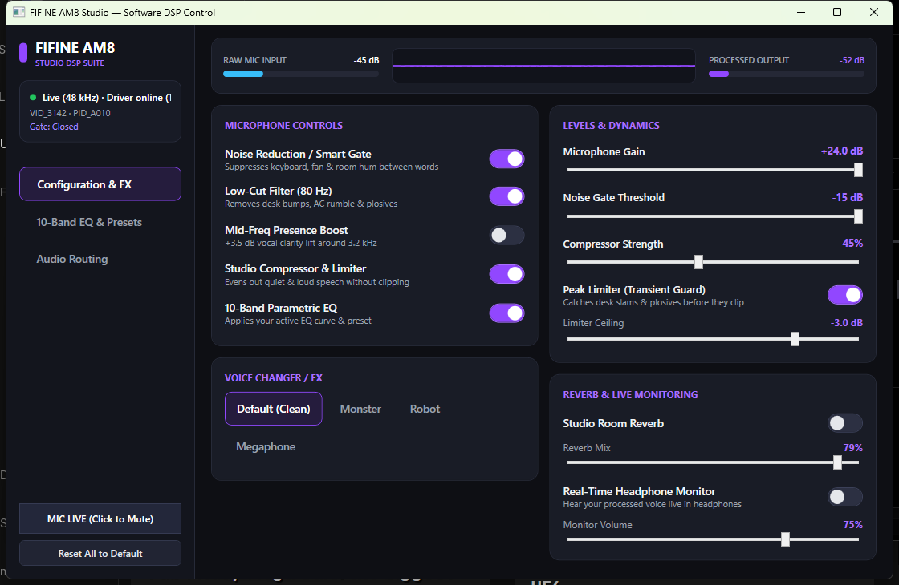

<div align="center">

# FIFINE AM8 Studio

**A native Windows DSP control panel for the FIFINE AM8 — built by reverse engineering FIFINE Genie's bundled protocols.**



[](https://dotnet.microsoft.com/)
[](https://learn.microsoft.com/dotnet/desktop/wpf/)
[](https://github.com/naudio/NAudio)
[](https://www.microsoft.com/)
[](LICENSE)

</div>

---

## Why this exists

FIFINE's official **Genie** app does not support the AM8 microphone (FIFINE's own FAQ says so). The AM8 still exposes a virtual microphone and a set of USB/HID/WASAPI interfaces, so all of the interesting DSP can be done in software instead. This project reverse engineered those interfaces from the shipped Genie installation and implements a complete, self-contained control panel:

- real-time audio DSP (WASAPI, 32-bit float)
- driver-level mute that actually reaches Discord/OBS
- live headphone monitoring on the device of your choice
- a lookahead brickwall limiter that kills desk-thump transients
- an exact 10-band EQ with the presets extracted from Genie's JS bundle

> **Note:** The AM8's **RGB lighting is controlled only by the physical button on the microphone**. FIFINE ships no software API for it, so this app deliberately does not pretend to control it.

---

## Features

| Category | Controls |
|---|---|
| **Input** | Gain (−24…+24 dB), noise gate / smart noise reduction (−65…−15 dB), 80 Hz low-cut, +3.5 dB presence boost @ 3.2 kHz |
| **EQ** | 10-band parametric EQ (31 → 16 kHz), live response curve, six extracted presets: Flat, Broadcast, Clarity, Deep Voice, Less Nasal, Walkie Talkie |
| **Dynamics** | Studio compressor (0–100%), **lookahead brickwall limiter** with adjustable ceiling (−12…−0.5 dB, default −3 dB) |
| **FX** | Monster / Robot / Megaphone voice changer, studio room reverb with mix control |
| **Monitoring** | Real-time sidetone to any render endpoint (auto-prefers headsets/headphones), volume control |
| **Routing** | Physical mic input → DSP → FIFINE virtual mic output; driver-level mute across all FIFINE endpoints |
| **Telemetry** | Live input/output dB meters, animated waveform, gate status badge, driver status |
| **Persistence** | All settings saved to `%APPDATA%\FifineAM8Studio\settings.json` |

---

## How it works

```
   FIFINE AM8 (physical mic)
            │  WASAPI capture (NAudio)
            ▼
   ┌──────────────────────────────────────────────┐
   │  Real-time DSP chain (32-bit float)          │
   │  low-cut → gate → 10-band EQ → presence      │
   │  → gain → compressor → voice FX → reverb     │
   │  → lookahead peak limiter → hard ceiling     │
   └──────────────────────────────────────────────┘
            ├──────────────► FIFINE virtual mic (render endpoint)
            │                    │  loopback
            │                    ▼  Discord / OBS / games
            └──────────────► Headphones (optional live monitor)

   Mute button ──► driver WebSocket ws://127.0.0.1:24925
                   setDeviceMute on every FIFINE endpoint
                   (so apps capturing the mic directly hear silence)
```

### What was reverse engineered

| Source | Finding | Used for |
|---|---|---|
| `index-Cibzib1Q.js` (Genie renderer) | WebSocket API at `ws://127.0.0.1:24925`: `getInputDeviceInfos`, `setDeviceMute`, `setDeviceVolume`, `switchDevice`, `setControlMode`, HID relay events | Driver-level mute and device discovery |
| Same bundle | Exact 10-band EQ frequencies, filter types and the six preset gain arrays | EQ implementation |
| `plugins/Feifan/AM8.js` (shipped device plugin) | Mic control packet family (`A5 5A FE …`) | Investigated for hardware control; not applicable to this AM8 variant |
| Live device probing | FIFINE virtual render → capture loopback works (verified with a 1 kHz tone) | DSP-to-Discord routing |

---

## Build

Requirements: **Windows 10/11**, **.NET 10 SDK**, a FIFINE AM8 (or any mic you want to route through the virtual device).

```powershell
git clone https://github.com/blacknwhite-beep/fifine-am8-studio.git
cd fifine-am8-studio
dotnet build FifineAM8Studio.csproj -c Release
```

Run it:

```powershell
.\bin\Release\net10.0-windows\FifineAM8Studio.exe
```

No installer and no driver changes are required. The app talks to the FIFINE driver controller if it is running; if it is not, live DSP and monitoring still work, only driver-level mute is unavailable.

---

## Usage — getting DSP into Discord / OBS

1. Open **Audio Routing** and confirm:
   - **Microphone Input** = `Microphone (fifine Microphone)`
   - **Virtual Mic Output** = `fifine - Microphone (fifine Virtual Audio Device)`
   - **Headphone Monitor Output** = your headset (auto-detected, e.g. Razer Nari)
2. In Discord / OBS / Windows sound settings, select **`fifine - Microphone (fifine Virtual Audio Device)`** as the input device.
3. Turn on **Real-Time Headphone Monitor** if you want to hear your own processed voice locally.
4. Tune EQ, gate, compressor and limiter. Changes are live and persist across restarts.

> The **Quick Mute** button mutes the FIFINE endpoints at the driver level too, so it silences apps that capture the mic directly.

---

## Project layout

```
fifine-am8-studio/
├── App.xaml / App.xaml.cs          # WPF application bootstrap
├── MainWindow.xaml                # UI (Configuration & FX / EQ / Routing tabs)
├── MainWindow.xaml.cs             # UI wiring, settings, meters
├── FifineAM8Studio.csproj         # .NET 10 WPF project (NAudio 2.2.1)
└── Audio/
    ├── AudioEngine.cs             # WASAPI capture, virtual output, monitor output
    ├── DspChain.cs                # Biquad EQ, gate, compressor, reverb, lookahead limiter
    └── FifineDriverClient.cs      # Reverse-engineered FIFINE driver WebSocket client
```

---

## Known limitations

- The AM8's RGB lighting is hardware-button-only; no software control exists.
- Driver-level mute requires the FIFINE driver controller (`fifineAudioDriverControler.exe`) to be running.
- The 10-band EQ and FX are heard in apps that use the **virtual microphone**. Apps locked to the physical mic bypass the DSP chain.
- Built and tested on Windows 11 with .NET 10; other Windows versions should work but are untested.

---

## License

MIT — see [LICENSE](LICENSE). Use it, change it, ship it.

<div align="center">

*Made by reverse engineering the software the manufacturer didn't ship for this mic.*

</div>
